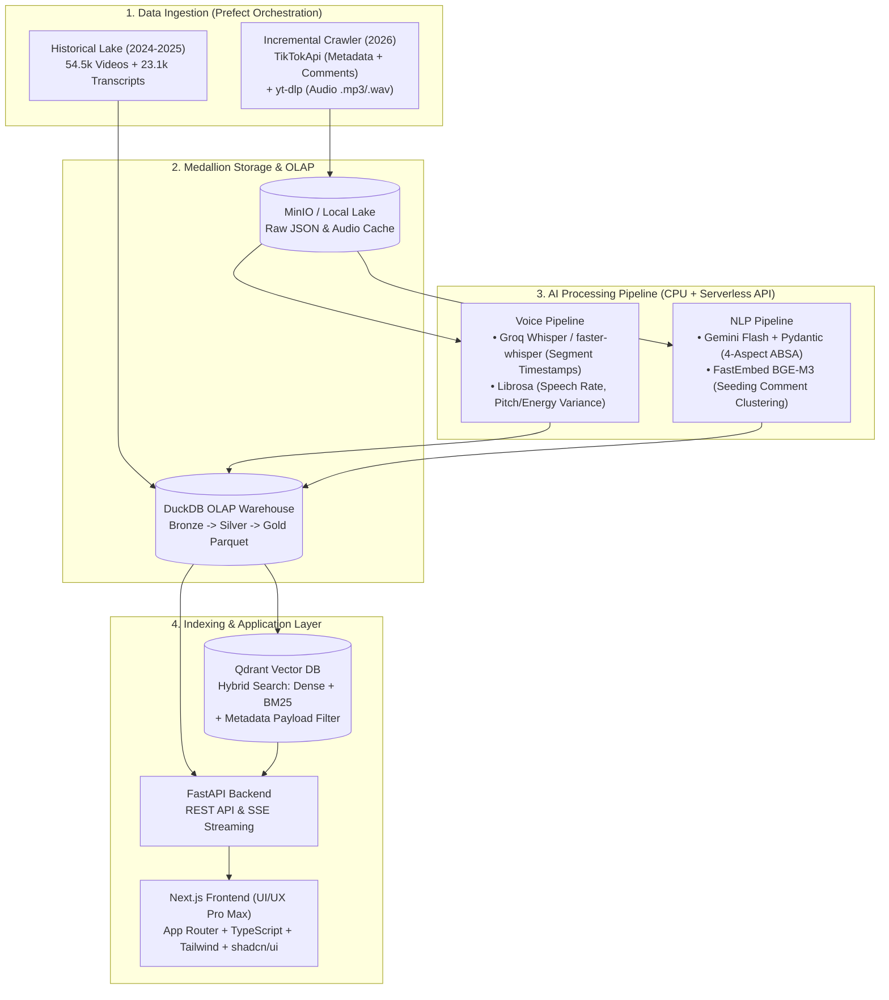

<div align="center">

# 🎙️🍜 Tiktok-Food-Review-Insight
**End-to-End Multimodal (Voice + NLP) Intelligence Platform for TikTok F&B Reviews & Seeding Detection**

[](https://nextjs.org/)
[](https://fastapi.tiangolo.com/)
[](https://www.prefect.io/)
[](https://duckdb.org/)
[](https://qdrant.tech/)

</div>

---

## 📌 Tổng quan Dự án (Project Overview)

**Tiktok-Food-Review-Insight** là hệ thống Data Engineering & AI Engineering hoàn chỉnh (End-to-End) chuyên phân tích dữ liệu đa phương thức (**Giọng nói Reviewer + Bình luận Người xem**) trong lĩnh vực **Review Ẩm thực & Quán ăn (F&B)** trên TikTok Việt Nam.

Hệ thống giải quyết 3 bài toán cốt lõi:
1. **Bóc tách Thông tin từ Giọng nói (Voice-to-Insight):** Chuyển đổi lời nói tốc độ cao trong video thành văn bản có gắn mốc thời gian từng câu (*Word/Segment-level Timestamps*), kết hợp phân tích đặc trưng âm học (`Librosa`) để nhận diện giọng đọc kịch bản quảng cáo.
2. **Đối chiếu Đa khía cạnh KOC vs. Khách hàng (ABSA Discrepancy):** Bóc tách tỷ lệ Khen/Chê theo 4 khía cạnh (**Hương vị – Giá cả – Vệ sinh/Không gian – Phục vụ**) và phát hiện độ lệch giữa lời khen của TikToker trong video với phản hồi thực tế dưới phần bình luận.
3. **Lọc Bình luận Seeding & Hỏi đáp RAG kèm Timestamp:** Tự động gom cụm, lọc bỏ bình luận seeding/spam và cung cấp trợ lý AI trả lời câu hỏi về quán ăn kèm trích dẫn phát đúng giây (`start_sec`) trong video gốc.

---

## 🏗️ Kiến trúc Hệ thống (System Architecture)



---

## 🚀 Bốn Tính năng Cốt lõi (Core Features)

| Module | Tính năng chính | Công nghệ |
| :--- | :--- | :--- |
| **1. F&B Aspect & Trend Dashboard** | • Phân tích xu hướng món ăn & địa điểm theo thời gian.<br>• Biểu đồ Radar/Bar đối chiếu điểm khen/chê 4 khía cạnh (*Hương vị, Giá cả, Vệ sinh, Phục vụ*) giữa **Lời nói KOC (Voice)** và **Bình luận Người xem (Comments)**. | `DuckDB`, `FastAPI`, `Next.js`, `Recharts` |
| **2. Voice Authenticity & Seeding Radar** | • Phân tích sóng âm (`Waveform`), tốc độ nói (`words/sec`) và độ biến thiên cao độ (`pitch variance`) để phát hiện giọng đọc kịch bản PR.<br>• Bộ lọc thông minh ẩn các bình luận nghi ngờ là Seeding/Spam. | `Librosa`, `FastEmbed (BGE-M3)`, `WaveSurfer.js` |
| **3. Timestamped Voice RAG Chatbot** | • Trợ lý AI hỏi đáp về quán ăn/món ăn dựa trên bình luận sạch và lời thoại video.<br>• Mỗi câu trả lời đính kèm **Chip mốc thời gian (`[🎬 @username | 00:42 - 00:55]`)**; bấm vào để nghe ngay đoạn âm thanh tại đúng giây đó. | `Qdrant (Hybrid Search)`, `Gemini Flash`, `FastAPI` |
| **4. Live On-Demand E2E Pipeline** | • Dán trực tiếp 1 URL video TikTok mới bất kỳ vào giao diện.<br>• Theo dõi trực tiếp (Real-time Stepper) quá trình thu thập Audio/Comments $\rightarrow$ Whisper & Librosa $\rightarrow$ ABSA & Seeding $\rightarrow$ Cập nhật vào `DuckDB` & `Qdrant` trong ~15 giây. | `Prefect`, `yt-dlp`, `TikTokApi`, `SSE` |

---

## 📚 Tài liệu Thiết kế & Lộ trình Triển khai (Project Documentation)

Toàn bộ tài liệu thiết kế kiến trúc, phân chia công việc và hướng dẫn nâng cấp hệ thống nằm trong thư mục [`docs/project_plan/`](docs/project_plan/):

1. 📄 **[01_project_overview_and_architecture.md](docs/project_plan/01_project_overview_and_architecture.md):** Chi tiết bài toán, sơ đồ kiến trúc E2E, lý do lựa chọn Tech Stack và mô tả 4 module.
2. 👥 **[02_team_work_distribution_and_roadmap.md](docs/project_plan/02_team_work_distribution_and_roadmap.md):** Phân chia công việc Full-Stack (Data Engineering + AI Engineering) cho 2 thành viên và lịch trình 14 ngày kèm tiêu chí nghiệm thu.
3. ♻️ **[03_legacy_reuse_and_refactoring_guide.md](docs/project_plan/03_legacy_reuse_and_refactoring_guide.md):** Kiểm kê 1.5GB dữ liệu lịch sử (54.5k videos, 23.1k transcripts, 14.2k food/location) và hướng dẫn nâng cấp mã nguồn.

---

## ⚙️ Hướng dẫn Cài đặt Nhanh (Quick Start)

### 1. Clone Repository & Cấu hình Biến môi trường
```bash
git clone git@github.com:NguyenVietNguyen2612/Tiktok-Food-Review-Insight.git
cd Tiktok-Food-Review-Insight

# Tạo file .env từ mẫu .env.example và điền API Keys
cp .env.example .env
```

### 2. Cài đặt Thư viện Python
```bash
pip install -r requirements.txt
playwright install chromium
```
