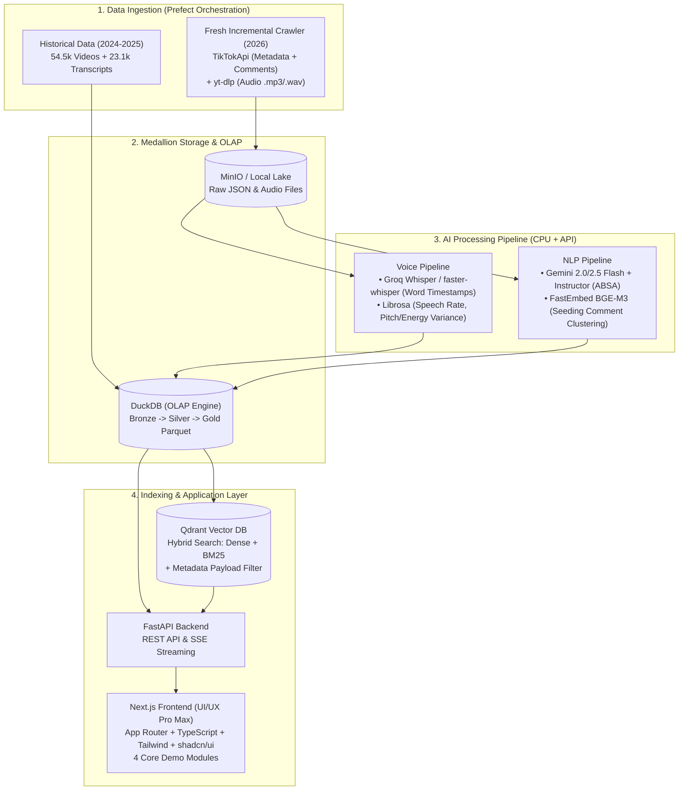

# 🎬 Tổng quan Dự án: Tiktok-Food-Review-Insight – Hệ thống E2E Phân tích Đánh giá Ẩm thực & Phát hiện Seeding Đa phương thức (Voice + NLP)

> [!IMPORTANT]
> **Mục tiêu cốt lõi của dự án:** Xây dựng một hệ thống dữ liệu và AI hoàn chỉnh (End-to-End) trong **2 tuần** dành cho nhóm **2 người**, tối ưu hóa cho máy tính **không có GPU (CPU-only + Serverless API)** nhằm tạo điểm nhấn mạnh mẽ trong CV ứng tuyển vị trí **Data Engineer** và **AI Engineer**.

---

## 1. Bài toán Thực tế (Problem Statement)

Trên TikTok Việt Nam, ngách **Review Ẩm thực & Quán ăn (F&B)** là một trong những chủ đề lớn nhất nhưng người xem và chủ quán đang đối mặt với 3 vấn đề:
1. **Thông tin nằm trong giọng nói (Voice-heavy):** Khen/chê về hương vị, giá cả, vệ sinh nằm rải rác trong lời nói của Reviewer với tốc độ nhanh, nhiều từ lóng và không có phụ đề chuẩn.
2. **Độ lệch giữa Quảng cáo (PR) và Trải nghiệm thật:** Nhiều video KOC nhận tiền quảng cáo khen quán nức nở (giọng đọc kịch bản đều đều), trong khi khách hàng thật lại phàn nàn ở phần bình luận.
3. **Bình luận bị nhiễu bởi Seeding/Bot:** Các chiến dịch seeding dùng văn mẫu hoặc tài khoản ảo làm loãng phản hồi thực tế dưới video.

👉 **Giải pháp – TikTok Pulse:** Nền tảng tự động thu thập Video Audio + Metadata + Bình luận $\rightarrow$ Phân tích Giọng nói (ASR Timestamp + Đặc trưng sóng âm) & Ngôn ngữ tự nhiên (ABSA + Lọc Seeding) $\rightarrow$ Cung cấp **Dashboard đối chiếu KOC vs Người dùng** và **Trợ lý AI RAG trả lời kèm trích dẫn đúng giây trong video**.

---

## 2. Kiến trúc Hệ thống End-to-End (System Architecture)

---

## 3. Lựa chọn Công nghệ & Lý do (Tech Stack Justification cho Phỏng vấn)

| Thành phần | Công nghệ sử dụng | Lý do lựa chọn (Điểm nhấn khi trả lời phỏng vấn) |
| :--- | :--- | :--- |
| **Orchestration** | `Prefect 3.x` | Nhẹ hơn Airflow, cấu hình Pythonic với `@flow` và `@task`, hỗ trợ retry, logging và trigger trực tiếp qua API. |
| **Analytical DB (OLAP)** | `DuckDB` | Viết bằng C++, chạy In-process trên CPU không tốn RAM nuôi server, truy vấn SQL trực tiếp trên hàng chục ngàn file `.parquet` và `.json` với tốc độ cực nhanh. |
| **Vector Database** | `Qdrant` | Viết bằng Rust (nhẹ, nhanh), hỗ trợ **Native Hybrid Search (Dense Vector + Sparse BM25)** và **Filterable HNSW** giúp vừa tìm chính xác tên món ăn/địa chỉ vừa lọc bỏ bình luận seeding. |
| **Voice Processing** | `Groq Whisper` / `faster-whisper` + `Librosa` | Tách lời thoại kèm mốc thời gian từng câu (Segment Timestamps) và đo đặc trưng âm học (Tốc độ nói từ/giây, độ biến thiên cao độ/năng lượng) hoàn toàn trên CPU. |
| **NLP & Structured LLM** | `Gemini Flash` + `Pydantic` + `FastEmbed` | Tận dụng cơ chế xoay vòng API key kết hợp Structured Outputs để bóc tách cảm xúc theo khía cạnh (ABSA) và nhúng vector bằng `BGE-M3` (ONNX CPU) để gom cụm bình luận seeding. |
| **Backend & Frontend** | `FastAPI` + `Next.js (App Router, TS, Tailwind, shadcn/ui)` (**UI/UX Pro Max**) | Thiết kế lại toàn bộ giao diện bằng **Next.js** theo chuẩn SaaS Analytics hiện đại (Bento Grid, Interactive Audio Waveform, Streaming Chat) thông qua bộ design system **UI/UX Pro Max**, tạo ấn tượng chuyên nghiệp vượt trội so với giao diện Streamlit mặc định. |

---

## 4. Bốn Tính năng Chính trên Ứng dụng Demo

### Tính năng 1: Bảng điều khiển Khía cạnh Ẩm thực (F&B Aspect & Trend Dashboard)
* Phân tích xu hướng món ăn, địa điểm qua các năm (kế thừa 54.500 video lịch sử + dữ liệu mới 2026).
* **Biểu đồ ABSA Radar/Bar:** Bóc tách tỷ lệ Khen/Chê chi tiết theo 4 khía cạnh: **Hương vị (Taste) – Giá cả (Price) – Không gian/Vệ sinh (Hygiene/Ambience) – Phục vụ (Service)**.
* **So sánh Độ lệch (KOC vs Viewer):** Đối chiếu cảm xúc trong lời nói của Reviewer (Voice) với cảm xúc trong Bình luận của người xem (Comments) để phát hiện quán ăn được PR quá đà.

### Tính năng 2: Máy quét Độ tin cậy Giọng nói & Bộ lọc Seeding (Voice & Seeding Radar)
* **Voice Prosody Analyzer:** Hiển thị sóng âm, tốc độ nói (`word_per_second`), độ biến thiên âm lượng/cao độ (`Librosa`) để đánh giá phong cách nói (Tự nhiên giàu cảm xúc vs Đọc kịch bản quảng cáo nhanh/đều).
* **Comment Seeding Cleanser:** Tự động gắn nhãn các bình luận nghi ngờ là Seeding/Spam (trùng lặp ngữ nghĩa cao, văn mẫu, spam link) và cho phép người dùng **gạt nút ẩn bình luận Seeding** ngay trên giao diện.

### Tính năng 3: Trợ lý Hỏi – Đáp Đa phương thức kèm Trích dẫn Giây (Timestamped Voice RAG)
* Cho phép hỏi tự nhiên: *"Ở Sài Gòn có quán bún bò nào ngon mà giá sinh viên không? Khách hay chê điểm gì?"*
* Truy xuất kết hợp từ `Qdrant` (lọc `is_seeding = False`), trả lời tổng hợp kèm **nút bấm mốc thời gian (ví dụ `[🎬 @ansapsaigon - 00:35]`)** để phát ngay đoạn âm thanh/video câu nói đó của TikToker.

### Tính năng 4: Đường ống Thu thập & Phân tích Trực tiếp (Live On-Demand Pipeline)
* Người dùng dán **1 đường link video TikTok mới bất kỳ** vào ô nhập liệu và bấm **"Chạy Pipeline"**.
* Hệ thống hiển thị tiến trình thời gian thực qua 4 bước (`Tải Audio & Comments` $\rightarrow$ `Whisper & Librosa` $\rightarrow$ `ABSA & Seeding Filter` $\rightarrow$ `Lưu DuckDB & Qdrant`) trong ~15 giây và hiển thị ngay kết quả phân tích.
