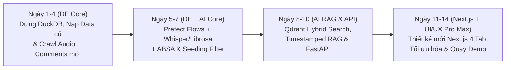

# 👥 Kế hoạch Phân chia Công việc (Full-Stack DE + AI cho cả 2 Người) & Lịch trình 14 Ngày

> [!IMPORTANT]
> **Nguyên tắc phân chia mới:** Để cả 2 thành viên đều ghi được đầy đủ kỹ năng **Data Engineering** (`Prefect`, `DuckDB`, `Data Pipeline`, `Crawler`) và **AI Engineering** (`Whisper`, `Librosa`, `LLM ABSA`, `Seeding Detection`, `Qdrant Hybrid RAG`) vào CV, công việc được chia theo **Luồng Dữ liệu Dọc (Vertical Feature Slices)** thay vì tách cứng 1 người chỉ làm Data, 1 người chỉ làm AI.

---

## 1. Ma trận Kỹ năng Đạt được của Cả 2 Thành viên (Dùng để viết CV)

| Mảng kỹ thuật | Thành viên A (**Luồng Video & Giọng nói - Voice Stream**) | Thành viên B (**Luồng Bình luận & Tương tác - NLP/Comment Stream**) |
| :--- | :--- | :--- |
| **Data Engineering (Thu thập & Lưu trữ)** | • Nâng cấp Crawler tải Audio (`.mp3`) bằng `yt-dlp` & Metadata video mới. • Thiết kế bảng `dim_users`, `fact_videos`, `fact_voice_segments` trong **DuckDB**. • Xây dựng Prefect Flow xử lý luồng Video & Audio. | • Nâng cấp Crawler lấy Bình luận (`comments`) & Replies từ `TikTokApi`. • Thiết kế bảng `fact_comments`, `fact_absa_reviews`, `dim_foods_locations` trong **DuckDB**. • Xây dựng Prefect Flow xử lý luồng Comments & Incremental Sync. |
| **AI Engineering (Xử lý Mô hình)** | • **Voice ASR & Prosody:** Tách lời thoại kèm mốc giây (`Whisper`) + Đo tốc độ nói, cao độ, năng lượng sóng âm (`Librosa`). • **LLM Extraction (Video):** Bóc tách khía cạnh khen/chê (ABSA) và giọng điệu quảng cáo từ lời nói của Reviewer. | • **Seeding & Bot Detection:** Nhúng vector bằng `FastEmbed (BGE-M3)` trên CPU + gom cụm phát hiện bình luận seeding/văn mẫu. • **LLM Extraction (Comments):** Chuẩn hóa teencode & bóc tách ABSA từ bình luận của người xem. |
| **Vector DB & RAG (`Qdrant` + `FastAPI`)** | • Đánh chỉ mục (Indexing) các phân đoạn giọng nói kèm `start_sec`, `end_sec` vào **Qdrant**. • Viết API & logic **Timestamped Voice RAG** (trả lời kèm trích dẫn giây trong video). | • Đánh chỉ mục (Indexing) bình luận sạch & thông tin quán ăn/địa điểm vào **Qdrant**. • Cấu hình **Hybrid Search (Dense + BM25) & Payload Filtering** + API đối chiếu KOC vs Người mua. |
| **Giao diện Demo (`Next.js` + `UI/UX Pro Max`)** | • Thiết kế mới trên **Next.js**: **Tab 2 (Voice Authenticity & Waveform Radar)** & **Tab 3 (Timestamped RAG Chatbot + Custom Audio Player)** bằng bộ quy chuẩn `ui-ux-pro-max`. | • Thiết kế mới trên **Next.js**: **Tab 1 (ABSA KOC vs Viewer Bento Dashboard)** & **Tab 4 (Live On-Demand Pipeline Stepper)** bằng bộ quy chuẩn `ui-ux-pro-max`. |

---

## 2. Lịch trình Chi tiết Từng Ngày (Ngày 1 $\rightarrow$ Ngày 14) & Tiêu chí Nghiệm thu

---

### 🔹 Giai đoạn 1: Xây dựng Hạ tầng Data Engineering & Thu thập Dữ liệu (Ngày 1 – Ngày 4)

#### **Ngày 1: Khởi tạo Hạ tầng & Thiết kế DuckDB Warehouse (Data Engineering)**
* **Thành viên A:**
  * Cài đặt môi trường (`duckdb`, `prefect`, `qdrant-client`, `yt-dlp`).
  * Viết script nạp dữ liệu lịch sử của User ([cleaned_user_info.parquet](file:///home/intern-nvnguyen1/Project/21KHDL-TikTok-Analytics/data/processed/cleaned_user_info.parquet)) và Video ([cleaned_video_info.parquet](file:///home/intern-nvnguyen1/Project/21KHDL-TikTok-Analytics/data/processed/cleaned_video_info.parquet), [content_analysis_data.parquet](file:///home/intern-nvnguyen1/Project/21KHDL-TikTok-Analytics/data/content_analysis/content_analysis_data.parquet)) vào bảng Bronze/Silver trong `tiktok_pulse.duckdb`.
* **Thành viên B:**
  * Dựng `docker-compose.yml` cho `Qdrant` và `MinIO` (hoặc cấu hình local storage).
  * Viết script đọc và làm sạch 23.122 file JSON trong [data/transcripts/](file:///home/intern-nvnguyen1/Project/21KHDL-TikTok-Analytics/data/transcripts) (xử lý lỗi control character bằng `strict=False`) và 14.252 file trong [data/foods-and-locations/](file:///home/intern-nvnguyen1/Project/21KHDL-TikTok-Analytics/data/foods-and-locations) nạp vào `tiktok_pulse.duckdb`.
* ✅ **Tiêu chí nghiệm thu Ngày 1:** Chạy câu lệnh SQL trên `tiktok_pulse.duckdb` trả về đúng ~54.500 videos kết nối (JOIN) được với 23.122 transcripts và 14.252 bản ghi món ăn/địa điểm trong < 1 giây.

#### **Ngày 2: Nâng cấp Crawler Đa phương thức – Audio & Comments (Data Engineering)**
* **Thành viên A:**
  * Tích hợp hàm tải audio từ [03_FE_01_01-Transcribe_audio_colab.ipynb](file:///home/intern-nvnguyen1/Project/21KHDL-TikTok-Analytics/notebooks/03_FE_01_01-Transcribe_audio_colab.ipynb) vào [src/crawler/crawler.py](file:///home/intern-nvnguyen1/Project/21KHDL-TikTok-Analytics/src/crawler/crawler.py) để tự động tải file `.mp3` nhẹ (64kbps) từ URL TikTok bằng `yt-dlp`.
* **Thành viên B:**
  * Mở rộng [src/crawler/crawler.py](file:///home/intern-nvnguyen1/Project/21KHDL-TikTok-Analytics/src/crawler/crawler.py) sử dụng class [`Comment`](file:///home/intern-nvnguyen1/Project/21KHDL-TikTok-Analytics/src/crawler/TikTokApi/api/comment.py#L13-L92) có sẵn để lấy top 50 bình luận (`cid`, `text`, `digg_count`, `create_time`, `user`) cho mỗi video.
* ✅ **Tiêu chí nghiệm thu Ngày 2:** Chạy thử nghiệm truyền vào 5 URL TikTok năm 2026 $\rightarrow$ Thu về đủ 5 file `.mp3`, 5 cục JSON metadata video và ~250 bình luận không bị lỗi chặn.

#### **Ngày 3: Chạy Batch Crawl Dữ liệu Mới 2026 & Chuẩn hóa API Rotator (DE + AI Prep)**
* **Thành viên A:**
  * Chạy script thu thập **150 – 200 video review ẩm thực mới nhất năm 2026** (tải toàn bộ file `.mp3` và metadata video).
  * Chuyển danh sách API key từ [development/apis.py](file:///home/intern-nvnguyen1/Project/21KHDL-TikTok-Analytics/development/apis.py) sang `.env` và viết module `APIKeyRotator` dùng chung cho cả nhóm (hỗ trợ Gemini API & Groq API).
* **Thành viên B:**
  * Chạy thu thập **~8.000 – 10.000 bình luận** tương ứng với 150 – 200 video mới đó và nạp vào bảng `raw_comments` trong `DuckDB`.
  * Refactor code chuẩn hóa tên món ăn & tỉnh/thành phố từ [03_FE_02_02-Explore_food_location_data.ipynb](file:///home/intern-nvnguyen1/Project/21KHDL-TikTok-Analytics/notebooks/03_FE_02_02-Explore_food_location_data.ipynb) thành hàm Python sạch.
* ✅ **Tiêu chí nghiệm thu Ngày 3:** Có đủ ~200 file `.mp3` mới trong thư mục lưu trữ, ~10.000 comments trong `DuckDB`, và test gọi `APIKeyRotator` 50 lần liên tiếp không bị lỗi `429 Rate Limit`.

#### **Ngày 4: Xây dựng Luồng Điều phối Tự động bằng Prefect (Data Engineering)**
* **Thành viên A:**
  * Đóng gói luồng **Video & Audio Ingestion** thành Prefect `@flow` và `@task` (có retry tự động khi mạng lỗi, ghi log thời gian chạy).
* **Thành viên B:**
  * Đóng gói luồng **Comment Ingestion & DuckDB Silver Transformation** (làm sạch bình luận, lọc trùng lặp, tách hashtag, tính điểm tương tác) thành Prefect `@flow`.
* ✅ **Tiêu chí nghiệm thu Ngày 4:** Mở Prefect UI (hoặc chạy CLI) thấy cả 2 Flow chạy xanh (`Completed`), dữ liệu tự động chảy từ Crawler vào các bảng Silver của `DuckDB`.

---

### 🔹 Giai đoạn 2: Phát triển Моdule AI Core – Voice & NLP (Ngày 5 – Ngày 7)

#### **Ngày 5: Xử lý Giọng nói (Voice ASR + Librosa) & Nhúng Ngữ nghĩa Bình luận (AI Engineering)**
* **Thành viên A (Voice AI):**
  * Viết module gọi `Groq Whisper API` (`whisper-large-v3-turbo`) hoặc `faster-whisper` tách lời thoại 200 file `.mp3` mới kèm **mốc thời gian từng câu (`start_sec`, `end_sec`)**.
  * Viết hàm `Librosa` chạy trên CPU tính 4 chỉ số cho mỗi file audio: Tốc độ nói (`words_per_sec`), Biến thiên cao độ (`pitch_std`), Năng lượng trung bình (`rms_energy`), Tỷ lệ nghỉ (`pause_ratio`).
* **Thành viên B (NLP Embedding & Clustering):**
  * Cài đặt `fastembed` (chạy ONNX trên CPU với mô hình đa ngôn ngữ `BAAI/bge-m3` hoặc `paraphrase-multilingual-MiniLM-L12-v2`).
  * Viết thuật toán **Phát hiện Bình luận Seeding/Spam**: Tính ma trận Cosine Similarity giữa các bình luận trong cùng 1 video + kiểm tra mật độ thời gian đăng (`create_time`) và regex từ khóa điều hướng/affiliate.
* ✅ **Tiêu chí nghiệm thu Ngày 5:**
  * Thành viên A: Bảng `fact_voice_segments` trong `DuckDB` có đầy đủ câu thoại kèm `start_sec`, `end_sec` và 4 chỉ số âm học từ `Librosa`.
  * Thành viên B: Bảng `fact_comments` có cột `is_seeding (True/False)`, `similarity_score` và `seeding_reason`.

#### **Ngày 6: Bóc tách Cảm xúc Đa khía cạnh – ABSA bằng Structured LLM (AI Engineering)**
* **Thành viên A (ABSA trên Lời nói Reviewer):**
  * Thiết kế Pydantic Schema và dùng `Gemini Flash` (qua `APIKeyRotator`) phân tích transcript của video để chấm điểm khen/chê (-1 đến +1) trên 4 khía cạnh: **Hương vị (`taste`), Giá cả (`price`), Vệ sinh/Không gian (`hygiene`), Phục vụ (`service`)**, đồng thời dự đoán xác suất video nhận quảng cáo (`sponsored_score` kết hợp từ lời nói + chỉ số đều giọng của `Librosa`).
* **Thành viên B (ABSA trên Bình luận Người xem):**
  * Dùng `Gemini Flash` (chế độ gom batch 20–30 bình luận thật/lần gọi để tiết kiệm quota và chạy siêu nhanh) để chuẩn hóa từ lóng/teencode và chấm điểm ABSA 4 khía cạnh từ góc nhìn của **khách hàng dưới phần bình luận**.
* ✅ **Tiêu chí nghiệm thu Ngày 6:** Bảng `fact_absa_comparison` trong `DuckDB` có thể đối chiếu trực tiếp từng video: *Điểm KOC chấm (Voice) vs Điểm Người xem chấm (Comments)* trên cả 4 khía cạnh.

#### **Ngày 7: Hợp nhất Pipeline DE + AI (End-to-End Integration 1)**
* **Thành viên A & B:**
  * Ghép các bước AI của Ngày 5 & Ngày 6 vào chung Prefect Flow của Ngày 4.
  * Viết các câu truy vấn SQL tạo tầng **Gold (Data Marts)** trên `DuckDB` phục vụ trực tiếp cho Dashboard.
* ✅ **Tiêu chí nghiệm thu Ngày 7:** Chạy 1 lệnh duy nhất kích hoạt Prefect Flow xử lý trọn vẹn 1 video mới từ URL $\rightarrow$ Audio/Comments $\rightarrow$ Whisper/Librosa $\rightarrow$ ABSA/Seeding $\rightarrow$ Lưu vào bảng Gold trong `DuckDB` dưới 15 giây.

---

### 🔹 Giai đoạn 3: Xây dựng Vector DB (`Qdrant`), Hybrid RAG & Backend API (Ngày 8 – Ngày 10)

#### **Ngày 8: Thiết kế Qdrant Collection & Indexing Pipeline (DE + AI Engineering)**
* **Thành viên A:**
  * Thiết kế Collection `tiktok_voice_segments` trên `Qdrant` lưu vector của từng phân đoạn lời nói (kèm payload: `video_id`, `author`, `start_sec`, `end_sec`, `foods`, `city`, `is_sponsored`).
  * Viết Prefect Task đồng bộ dữ liệu transcript có timestamp từ `DuckDB` sang `Qdrant`.
* **Thành viên B:**
  * Thiết kế Collection `tiktok_clean_reviews` trên `Qdrant` bật chế độ **Hybrid Search (Dense Vector + Sparse BM25)** lưu bình luận đã lọc sạch (`is_seeding = False`) và bản tóm tắt quán ăn/món ăn từ tập dữ liệu lớn.
  * Viết Prefect Task đồng bộ dữ liệu từ `DuckDB` sang `Qdrant`.
* ✅ **Tiêu chí nghiệm thu Ngày 8:** Mở giao diện Qdrant Dashboard (`http://localhost:6333/dashboard`) thấy đủ 2 Collections với đầy đủ Vector và Metadata Payload.

#### **Ngày 9: Xây dựng Agentic / Hybrid RAG kèm Trích dẫn Giây (AI Engineering)**
* **Thành viên A:**
  * Viết module truy xuất và tổng hợp câu trả lời từ các phân đoạn giọng nói: Khi người dùng hỏi về một món ăn/quán ăn, LLM trả lời và gắn kèm thẻ trích dẫn `[🎬 @username | 00:35 - 00:50]`.
* **Thành viên B:**
  * Viết bộ định tuyến truy vấn (Query Router / Metadata Extractor): Tự động bóc tách từ câu hỏi của người dùng ra bộ lọc Qdrant (ví dụ: hỏi *"Quán phở nào ở Hà Nội bị chê về vệ sinh?"* $\rightarrow$ tự lọc `city="Hà Nội"`, `aspect="hygiene"`, `sentiment="Negative"`, `is_seeding=False`) trước khi thực hiện Hybrid Search.
* ✅ **Tiêu chí nghiệm thu Ngày 9:** Test 10 câu hỏi thực tế trên terminal $\rightarrow$ Hệ thống trả về câu trả lời chính xác, đối chiếu cả lời TikToker nói (kèm đúng mốc giây `start_sec`) và ý kiến khách bình luận, thời gian phản hồi < 3 giây.

#### **Ngày 10: Xây dựng FastAPI Backend (Software / Data Engineering)**
* **Thành viên A:**
  * Viết các API endpoints cho Voice Analysis (`/api/v1/voice/{video_id}`) và RAG Chat (`/api/v1/chat/query`).
* **Thành viên B:**
  * Viết các API endpoints cho Market & ABSA Dashboard (`/api/v1/analytics/absa`, `/api/v1/comments/{video_id}`) và Trigger Live Pipeline (`/api/v1/pipeline/ingest-url`).
* ✅ **Tiêu chí nghiệm thu Ngày 10:** Mở trang Swagger UI (`http://localhost:8000/docs`) test toàn bộ các endpoints trả về HTTP 200 với JSON chuẩn.

---

### 🔹 Giai đoạn 4: Thiết kế Giao diện `Next.js` bằng `UI/UX Pro Max` & Đóng gói (Ngày 11 – Ngày 14)

#### **Ngày 11: Khởi tạo `Next.js` + Design System (`ui-ux-pro-max`) & Xây dựng Tab 1 + Tab 2**
* **Cả 2 thành viên:**
  * Khởi tạo dự án **Next.js (App Router, TypeScript, TailwindCSS, shadcn/ui)** và áp dụng `ui-ux-pro-max` để thiết lập Design System thống nhất (Bảng màu SaaS Analytics, Typography hiện đại, Bento Grid Layout, Micro-interactions).
* **Thành viên B (Phụ trách Tab 1 – Market & Aspect Bento Dashboard):**
  * Chỉ giữ lại **công thức tính toán số liệu** từ code cũ ở tầng Backend, thiết kế mới hoàn toàn giao diện Dashboard trên **Next.js** (`Recharts` / `Tremor` + `shadcn/ui`).
  * Xây dựng biểu đồ Radar/Bar đối chiếu **Điểm khen/chê của Reviewer (Voice) vs Người mua (Comments)** theo 4 khía cạnh.
* **Thành viên A (Phụ trách Tab 2 – Voice & Seeding Radar):**
  * Thiết kế mới màn hình hiển thị sóng âm tương tác trên **Next.js** (Interactive Waveform / `WaveSurfer.js`), thẻ chỉ số tốc độ nói (`words_per_sec`), biến thiên cao độ (`Librosa`) + badge đánh giá giọng đọc kịch bản.
  * Xây dựng bảng bình luận hiện đại có **Nút gạt (Animated Switch) "Ẩn bình luận Seeding/Spam"** kết nối API của Thành viên B.
* ✅ **Tiêu chí nghiệm thu Ngày 11:** Giao diện Next.js ở Tab 1 và Tab 2 đạt chuẩn thẩm mỹ SaaS chuyên nghiệp (Responsive, hiệu ứng chuyển cảnh mượt, tách biệt hoàn toàn Backend FastAPI và Frontend Next.js).

#### **Ngày 12: Thiết kế Mới Tab 3 (Timestamped RAG) & Tab 4 (Live Pipeline Stepper)**
* **Thành viên A (Phụ trách Tab 3 – Timestamped Voice RAG Chatbot):**
  * Thiết kế giao diện AI Chat hiện đại (Streaming text, Citation chips).
  * Khi người dùng bấm vào chip trích dẫn `[🎬 @username | 00:42 - 00:55]`, trình phát Audio/Video cố định bên cạnh sẽ tự động nhảy (`seekTo(42)`) và phát ngay từ giây thứ 42.
* **Thành viên B (Phụ trách Tab 4 – Live On-Demand Pipeline & System Metrics):**
  * Thiết kế màn hình nhập URL TikTok kèm **Real-time Pipeline Stepper** (cập nhật trạng thái từng bước qua SSE/WebSocket hoặc Polling từ Prefect/FastAPI) và các thẻ System Health (`DuckDB` rows, `Qdrant` vectors).
* ✅ **Tiêu chí nghiệm thu Ngày 12:** Bấm vào chip thời gian trong Chatbot nhảy đúng giây thứ 42; dán 1 link TikTok mới vào Tab 4 thấy hiệu ứng chạy qua 4 bước trực quan từ đầu đến cuối.

#### **Ngày 13: Kiểm thử Tích hợp Frontend–Backend, Tối ưu Hiệu năng & Làm sạch Repo**
* **Thành viên A & B:**
  * Tối ưu tốc độ phản hồi API (caching trên FastAPI/DuckDB), xử lý trạng thái Loading Skeleton và Error Toast trên giao diện mới.
  * Dọn dẹp thư mục `src/app` (Streamlit cũ), kiểm tra `.gitignore` đảm bảo không lộ `.env` chứa API keys.
* ✅ **Tiêu chí nghiệm thu Ngày 13:** Chạy hệ thống E2E (`Backend + Frontend + Qdrant`) không có lỗi console, tốc độ tải dashboard < 500ms.

#### **Ngày 14: Viết Tài liệu Kiến trúc (`README.md`), Quay Video Demo & Chuẩn bị Phỏng vấn**
* **Thành viên A:** Viết phần Kiến trúc Voice AI, Librosa, Timestamped RAG và Data Schema vào `README.md`.
* **Thành viên B:** Viết phần Kiến trúc Prefect Pipeline, DuckDB Medallion, Seeding Detection, Hybrid Search và Hướng dẫn cài đặt vào `README.md`.
* **Cả 2:** Quay video demo 3 phút theo đúng kịch bản 4 Tab và tổng hợp các gạch đầu dòng (Bullet points) đưa vào CV.
* ✅ **Tiêu chí nghiệm thu Ngày 14 (Final Deliverable):** Hoàn tất toàn bộ mã nguồn, tài liệu và video demo.
